# Actividad 4 — API REST con Spring Boot, Spring Security y JWT

API REST pura (sin vistas) construida con **Spring Boot**, **MySQL**, **Spring Security** y **JWT**. Incluye registro y login con token real, un CRUD de estudiantes protegido, DTOs, validación de entrada y manejo uniforme de errores. Probada y documentada con **Bruno**.

**API desplegada en el VPS:** `http://165.22.188.79:8087`

## Tecnologías

- Java 21
- Spring Boot 4.1.2 (Web MVC, Data JPA, Validation)
- Spring Security 7 + JWT (jjwt 0.12.6)
- MySQL 8
- Lombok
- Bruno (colección de pruebas incluida en el repositorio)

## Funcionalidades

- Registro y login con token JWT firmado (HS256 / HMAC).
- Contraseñas guardadas con BCrypt; el password nunca se devuelve en una respuesta.
- Todos los endpoints del CRUD exigen un token válido (`Authorization: Bearer <token>`).
- Sin token o con token inválido responde **401** en JSON.
- DTOs de entrada y salida; las entidades JPA no se exponen.
- Validación con `@Valid` (`@NotBlank`, `@Email`, `@Size`) y errores claros en JSON.
- Listado con paginación.
- Códigos HTTP apropiados con `ResponseEntity`.

## Endpoints

### Autenticación (públicos)

| Método | Ruta | Descripción | Éxito | Errores |
|---|---|---|---|---|
| POST | `/api/auth/register` | Registra un usuario y devuelve un token | 201 | 400, 409 |
| POST | `/api/auth/login` | Inicia sesión y devuelve un token | 200 | 400, 401 |

### Estudiantes (requieren token)

| Método | Ruta | Descripción | Éxito | Errores |
|---|---|---|---|---|
| GET | `/api/v1/students?page=0&size=10` | Lista paginada | 200 | 401 |
| GET | `/api/v1/students/{id}` | Ver un estudiante | 200 | 401, 404 |
| POST | `/api/v1/students` | Crear | 201 | 400, 401, 409 |
| PUT | `/api/v1/students/{id}` | Actualizar | 200 | 400, 401, 404, 409 |
| DELETE | `/api/v1/students/{id}` | Eliminar | 204 | 401, 404 |

### Ejemplos de cuerpo

Registro:
```json
{ "name": "Usuario Demo", "email": "usuario.demo@correo.com", "password": "12345678" }
```

Login (respuesta):
```json
{ "token": "eyJhbGciOi...", "type": "Bearer", "expiresIn": 86400000 }
```

Estudiante:
```json
{ "firstName": "Maria", "lastName": "Gomez", "email": "maria.gomez@correo.com" }
```

Error de validación (400):
```json
{
  "timestamp": "2026-11-12T19:00:00",
  "status": 400,
  "error": "Bad Request",
  "message": "Datos de entrada invalidos",
  "errors": { "email": "El email no tiene un formato valido" }
}
```

## Cómo funciona la seguridad

1. El cliente se registra o hace login y recibe un JWT.
2. En cada petición protegida envía `Authorization: Bearer <token>`.
3. `JwtAuthenticationFilter` extrae el token, verifica su firma y su expiración y carga al usuario.
4. Si es válido, la petición llega al controller; si no, Spring Security responde **401**.

La sesión es *stateless* (no hay cookies de sesión) y CSRF está deshabilitado porque la API se autentica solo con el token.

## Estructura del proyecto

```
src/main/java/com/example/crudrapido
├── controller   AuthController, StudentController
├── service      AuthService, StudentService
├── repository   UserRepository, StudentRepository
├── entity       User, Role, Student
├── dto          RegisterRequest, LoginRequest, AuthResponse,
│                StudentRequest, StudentResponse, PageResponse, ErrorResponse
├── security     JwtService, JwtAuthenticationFilter,
│                CustomUserDetailsService, SecurityConfig
└── exception    GlobalExceptionHandler, ResourceNotFoundException,
                 EmailAlreadyExistsException
```

## Ejecutar en local

Requisitos: Java 21 y MySQL.

1. Crear la base de datos:
   ```sql
   CREATE DATABASE crudrapido CHARACTER SET utf8mb4 COLLATE utf8mb4_unicode_ci;
   ```
2. Copiar `src/main/resources/application.properties.example` a `src/main/resources/application.properties` y poner tus datos (usuario, password de MySQL y una `jwt.secret` de al menos 32 caracteres). Ese archivo no se sube al repositorio.
3. Ejecutar:
   ```bash
   ./mvnw spring-boot:run
   ```
4. La API queda en `http://localhost:8080`.

## Colección de Bruno

La colección está en la carpeta [`Act4 API 1`](<Act4 API 1>) y se abre con Bruno (*Open Collection*).

- **Entornos:** `local` (`http://localhost:8080`) y `vps` (`http://165.22.188.79:8087`).
- El login guarda el token en una variable y el resto de las peticiones lo usan automáticamente.
- Orden: `1-Auth` (registro, login) → `2-Students` (crear, listar, ver, actualizar, eliminar) → `3-Seguridayvalidation` (sin token, validación, login incorrecto).
- Cada petición incluye una aserción del código de estado esperado.

## Despliegue en el VPS

- Ubuntu 24.04, la aplicación corre como servicio `systemd` en el puerto **8087**, independiente de las actividades anteriores.
- Base de datos propia (`act4_db`) con un usuario dedicado.
- La configuración (credenciales de BD y clave JWT) se pasa con variables de entorno, no está en el repositorio.
- Empaquetado: `./mvnw clean package -DskipTests` y copia del `.jar` con `scp`.

## Capturas de pantalla (Bruno contra el VPS)

### Registro — 201
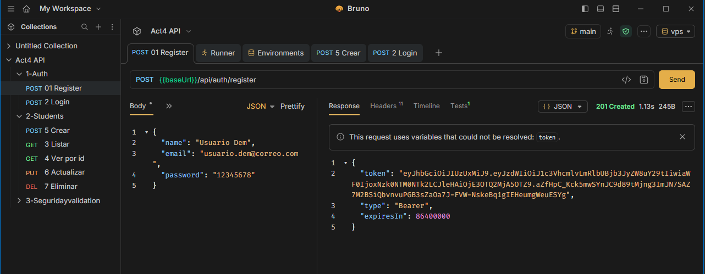

### Login — 200
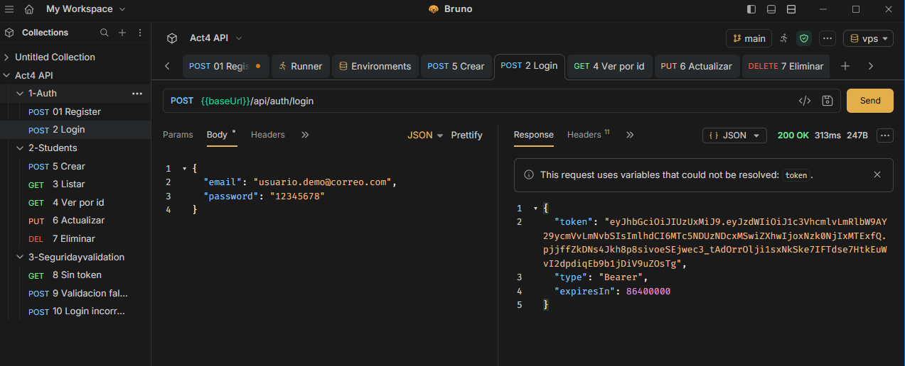

### CRUD con token

**Crear — 201**
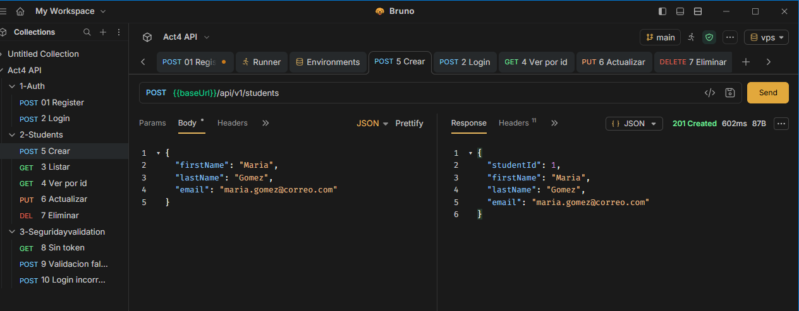

**Listar con paginación — 200**
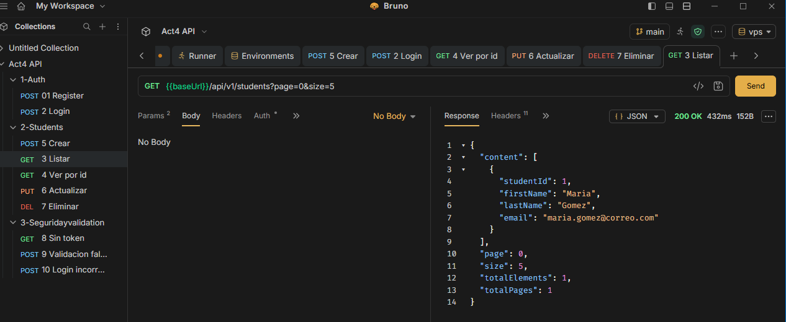

**Ver por id — 200**
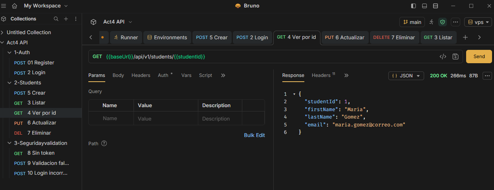

**Actualizar — 200**
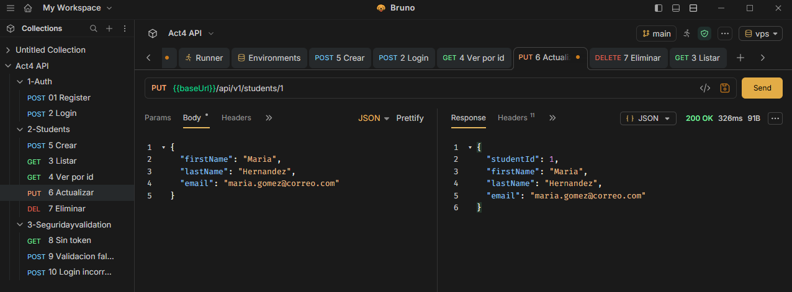

**Eliminar — 204**
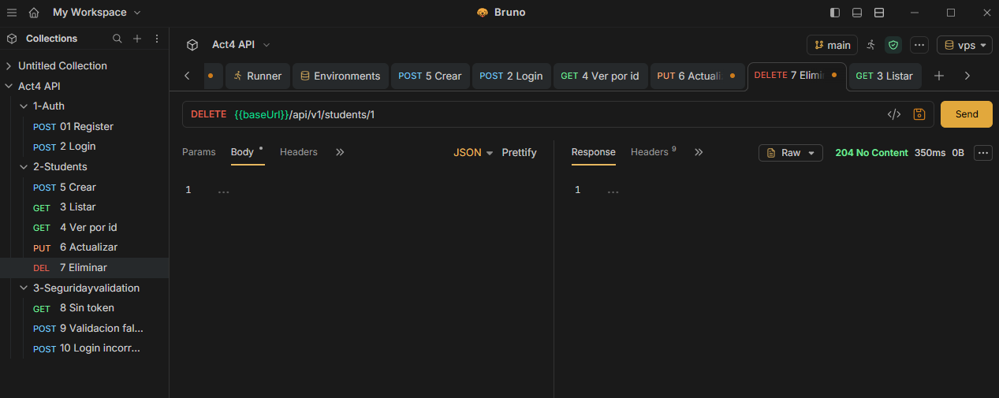

### Seguridad y validación

**Petición sin token — 401**
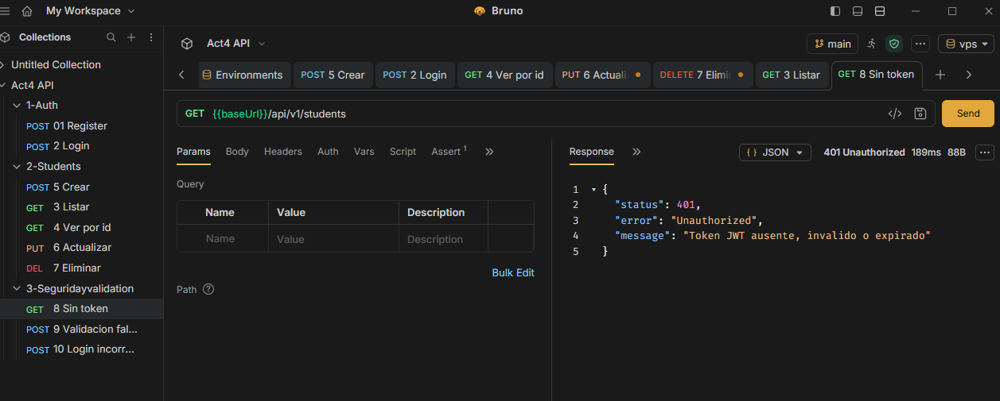

**Validación fallida — 400**
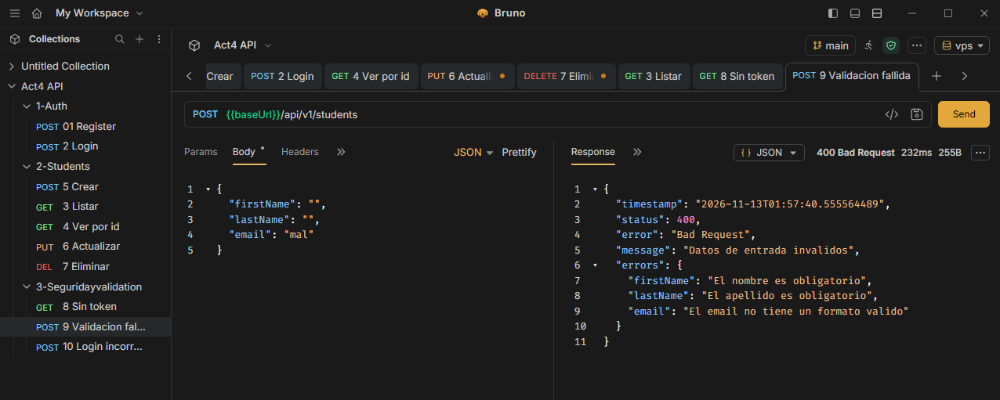

**Login incorrecto — 401**
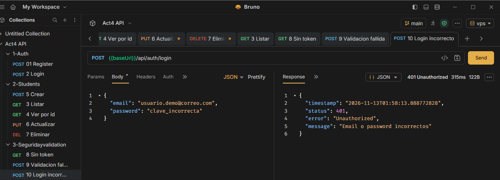

### Colección completa (Runner de Bruno, 10/10 pasadas)
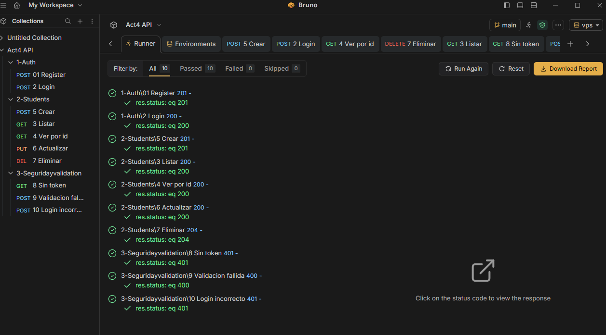

### Pruebas en local
Las capturas hechas contra `localhost` están en [`docs/capturas`](docs/capturas).